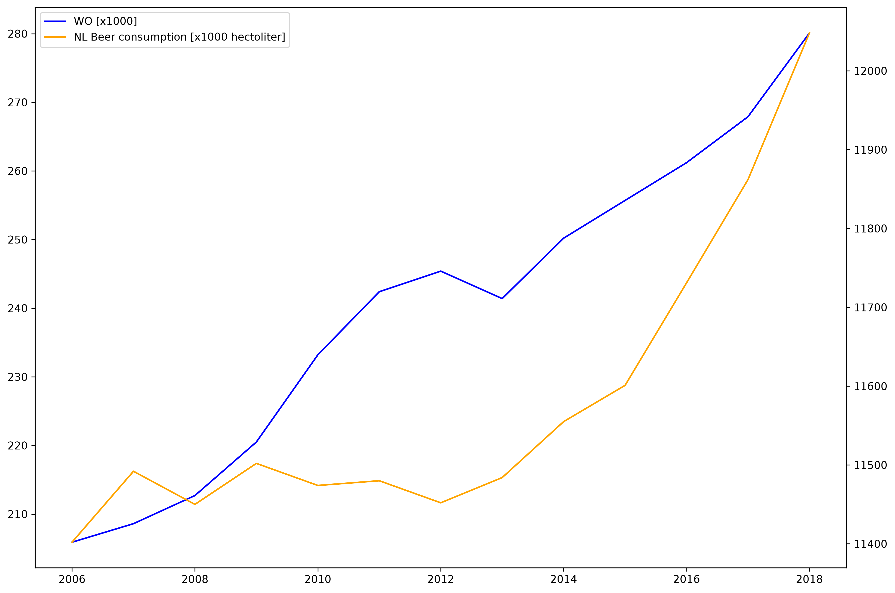

**Student ID:** 17098742

- Fantastic yeasts and where to find them: the hidden diversity of dimorphic fungal pathogens
- An analysis of the forces required to drag sheep over various surfaces
- The neurocognitive effects of alcohol on adolescents and college students

```python
import matplotlib.pyplot as plt
import pandas as pd

data = pd.read_csv("./istherecorrelation.csv", sep=';', decimal=',')
cols = [
    "WO [x1000]",
    "NL Beer consumption [x1000 hectoliter]"
]

fig, axis = plt.subplots(figsize=(12, 8), sharex=True, dpi=300)
axis.plot(data["Year"], data[cols[0]], label=cols[0], color="blue")
axis2 = axis.twinx()
axis2.plot(data["Year"], data[cols[1]], label=cols[1], color="orange")
plt.xlabel("Year")
l1, la1 = axis.get_legend_handles_labels()
l2, la2 = axis2.get_legend_handles_labels()
plt.legend(l1 + l2, la1 + la2, loc="best")
plt.tight_layout()
plt.show()
```



```python
corr = data[cols[0]].corr(data[cols[1]])
print(f"Correlation: {corr}")
```

The correlation comes out to ≈0.818064, which implies a strong correlation
between the number of university students currently enrolled, and the amount of
beer consumed in the Netherlands. However, this cannot be taken at face value
since it is not specified whether the same population was surveyed and how much
the student population actually affects beer consumption.
